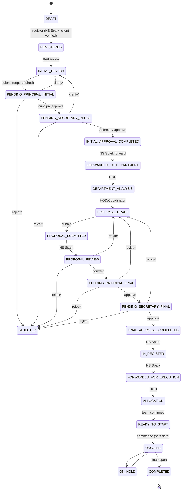
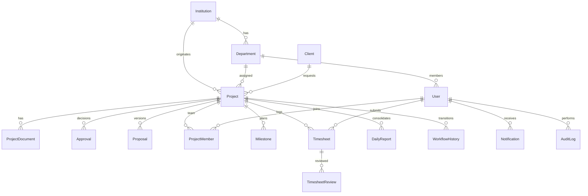

# NS Spark – Architecture

## 1. Stack
Next.js 15 (App Router, TS) · Tailwind · Prisma 6 · SQLite for local dev (PostgreSQL in production: change `provider` and `DATABASE_URL`, run `prisma migrate deploy`; the schema uses only portable types, no native enums) · session cookie (signed JWT via `jose`, bcrypt hashes) · exceljs / pdfkit for exports.

Layers: `src/lib/workflow` (pure state machine, no I/O) → `src/lib/services` (transactional use-cases: transition + history + audit + notification in ONE DB transaction) → route handlers / server actions → UI. UI never writes status directly; every status change goes through `transition()`.

## 2. Status tracks (conflict resolution)
The 27 statuses mix three concerns. They are stored as one master `Project.status` (single source of truth, driven by the engine) plus derived tracks used for filtering/reporting:

| Track | Statuses |
|---|---|
| Initial approval | Registered … Initial Approval Completed |
| Proposal approval | Forwarded to Department … Added to Approved Register |
| Execution | Forwarded for Execution … Completed |

Statuses 20–23 (Timesheet Submission, Faculty Verification, HOD Verification, NS Spark Monitoring) are *per-timesheet / per-report* states (`Timesheet.status`, `DailyReport.status`), not project states; a project stays `ONGOING` while they cycle. Clarification/revision returns restart the relevant approval chain from NS Spark (Principal → Secretary order is never skipped).

## 3. State machine (project)

`*` remarks mandatory. Any non-terminal state → CANCELLED (NS Spark/Admin, remarks).

## 4. Role–permission matrix
| Capability | Admin | NS Spark | Principal | Secretary | HOD | Faculty | Student |
|---|---|---|---|---|---|---|---|
| Users/institutions/departments | ✔ | – | – | – | – | – | – |
| Register / screen project | – | ✔ | – | – | – | – | – |
| Initial approval step 1 | – | – | ✔ | – | – | – | – |
| Initial approval step 2 | – | – | – | ✔ | – | – | – |
| Forward to dept / register | – | ✔ | – | – | – | – | – |
| Assign coordinator | – | – | – | – | ✔ | – | – |
| Draft/submit proposal | – | – | – | – | ✔ | ✔ (assigned) | – |
| Review proposal | – | ✔ | – | – | – | – | – |
| Final approval step 1 / 2 | – | – | ✔ / – | – / ✔ | – | – | – |
| Allocate team, commence | – | – | – | – | ✔ | ✔ (coordinator) | – |
| Student timesheet | – | – | – | – | – | – | ✔ (own) |
| Verify student timesheet | – | – | – | – | – | ✔ (project coord.) | – |
| Faculty timesheet | – | – | – | – | – | ✔ (own) | – |
| HOD review | – | – | – | – | ✔ (own dept) | – | – |
| Monitor / daily & weekly report | – | ✔ | view | view | dept | project | own |
| Audit log | ✔ | view | – | – | – | – | – |

Data isolation: Principal/HOD/Faculty/Student queries are scoped by institution, department and project membership in the service layer.

## 5. ER overview

Full definition: `prisma/schema.prisma`.
